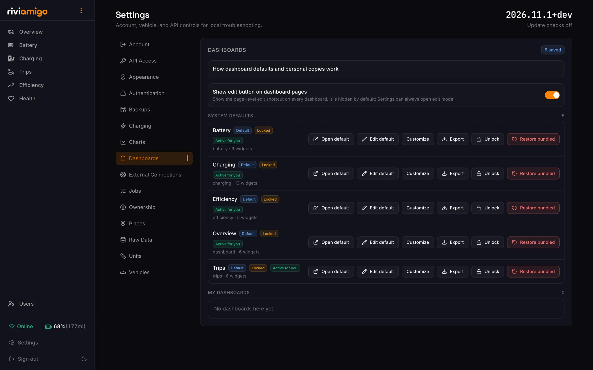

# Manage dashboards

Riviamigo keeps an installation-wide system version of each built-in dashboard and can also keep personal dashboards for each user. Open **Settings > Dashboards** to see which version you are managing.

To change what a dashboard shows, see [Edit a dashboard](./dashboard-editing.md), [Vehicle Overview](./vehicle-overview.md), and [Sensor chips](./sensor-chips.md).

## System defaults and personal copies

System defaults are shared within your Riviamigo installation. Administrators and super users can edit them, and those changes affect everyone who has not made a personal override.

Choose **Customize** on a system row to create your own copy with the same dashboard slug. That copy becomes **Active for you** and takes precedence when you open the normal dashboard route. Customizing does not change the system version or another user's view.

Settings actions target the row they appear on:

- **Open default** and **Edit default** open the exact system row, even if you have a personal copy.
- **Open** and **Edit** on a personal row open that exact copy.
- **Duplicate** creates an independent personal dashboard from an existing personal dashboard.
- **Export** downloads the selected row as YAML, including conditional visibility rules.
- **Lock** and **Unlock** (administrators only) set whether anyone other than an administrator can change that dashboard.

Administrators who edit a built-in dashboard from its page change the system default for everyone. Other users who edit a built-in dashboard save a personal copy. See [Who sees your changes](./dashboard-editing.md#turn-on-edit-mode).

## Reset, delete, and restore

The recovery action depends on who owns the row:

- **Reset to default** deletes a same-slug personal override. The system version immediately becomes active for that user again.
- **Delete** removes a standalone personal dashboard that does not override a system slug.
- **Restore bundled** is an administrator action for system defaults. It replaces that system row with the layout shipped in the installed Riviamigo version.

For the administrator performing the restore, the saved default for the restored
managed Overview chart is also aligned with the chart in that bundle. Other
users' chart preferences are unchanged.

Resetting a personal copy does not restore or modify the system row. Restoring a bundled system dashboard does not delete personal copies. Personal dashboards are never replaced by an upgrade: saved widgets, positions, and settings remain yours. A release may apply a narrow additive patch for a bundled widget explicitly marked as managed, preserving the existing layout while adding fixed page composition that is not editor-configurable. System edits survive ordinary restarts, but a release that intentionally ships a newer dashboard baseline updates the shared system row once; users with a same-slug personal copy continue to see their own version plus any managed composition additions.
