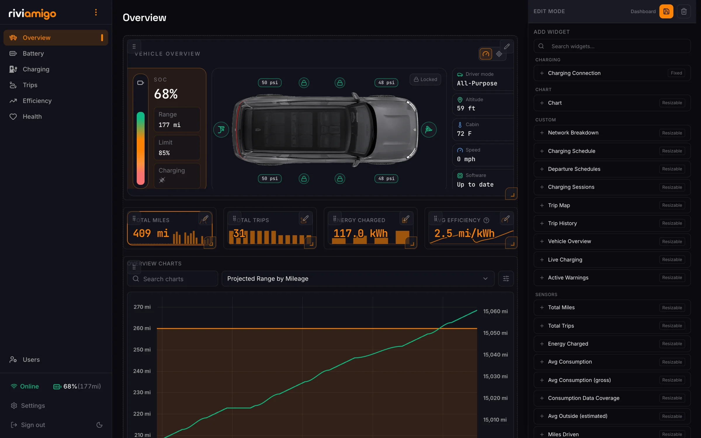
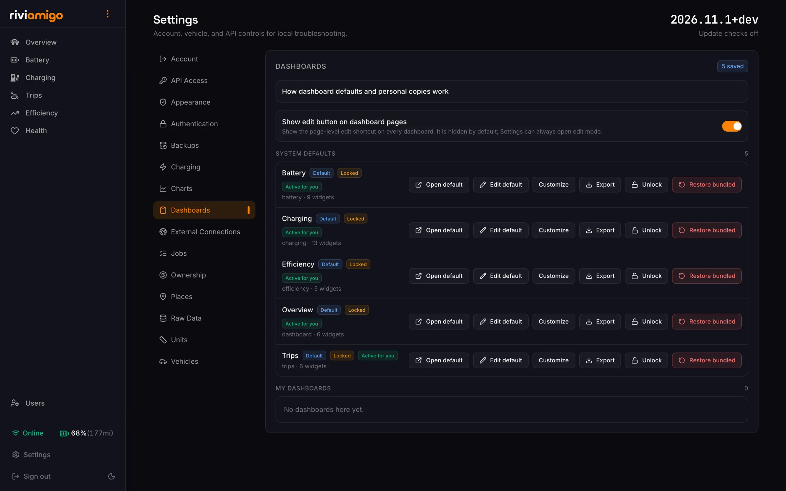
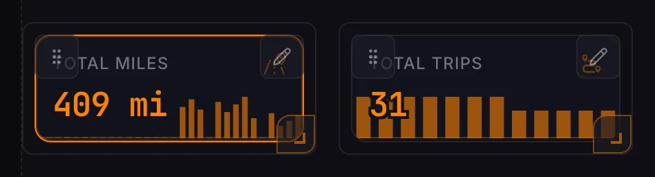
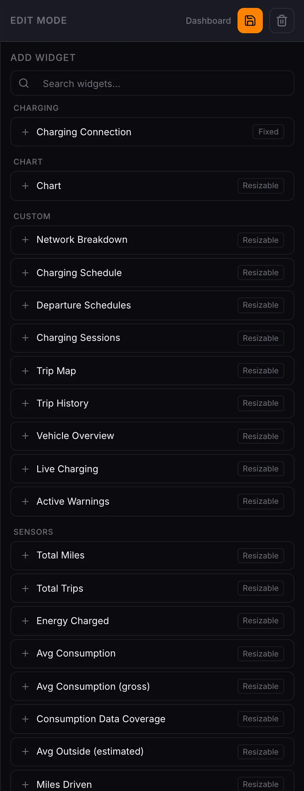
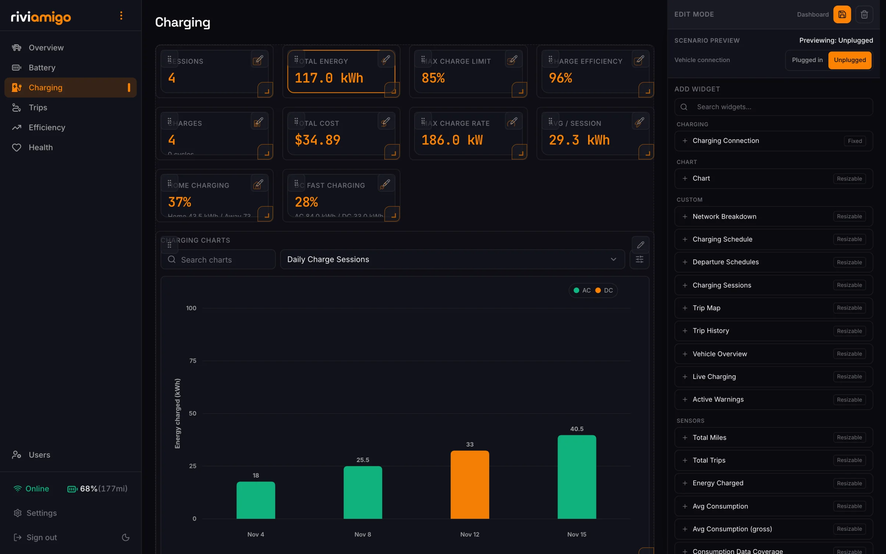
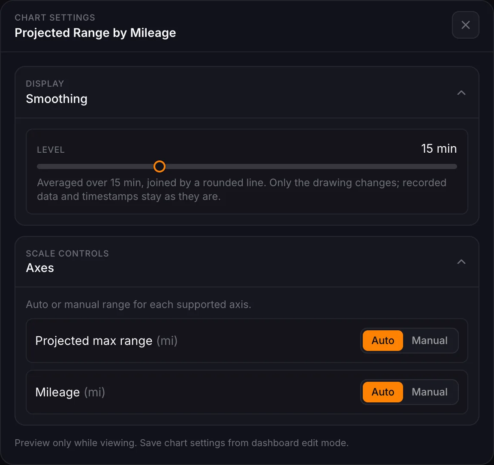
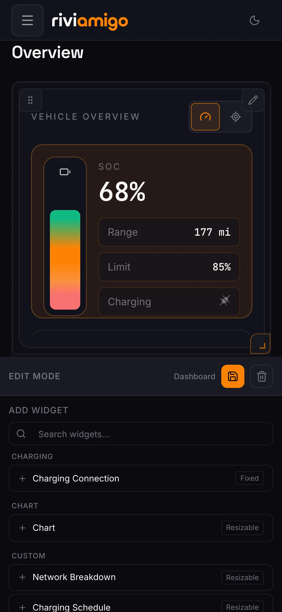

# Edit a dashboard

Every Riviamigo dashboard (Overview, Battery, Charging, Trips, and Efficiency)
is a grid of widgets you can rearrange and reconfigure. You can move and resize
widgets, add new ones from a catalog, change what each one shows, and hide a
widget unless the vehicle is plugged in or unplugged. Nothing changes until you
press **Save**.

The grid holds four kinds of widget:

| Widget | What it is | Learn more |
| --- | --- | --- |
| **Sensor chips** | Compact cards with one value, such as Total Miles or Usable Capacity, optionally over a small background graph. | [Sensor chips](./sensor-chips.md) |
| **Vehicle Overview** | The large panel at the top of the Overview page: battery, vehicle image, tire pressures, locks, five stat rows, and the location map. | [Vehicle Overview](./vehicle-overview.md) |
| **Charts** | A chart with a dropdown of related charts, such as the Battery or Charging charts. | [Chart widgets](#chart-widgets) below |
| **Custom widgets** | Purpose-built panels such as Charging Connection, Charging Sessions, Trip Map, and Trip History. | [Add a widget](#add-a-widget) |

## Turn on edit mode

There are two ways in:

- **From the dashboard page.** Open **Settings > Dashboards** and turn on
  **Show edit button on dashboard pages**. A pencil then appears next to each
  dashboard's title. Click it to start editing that page. The setting is per
  user, and it is off by default.
- **From Settings.** In **Settings > Dashboards**, use **Edit default**,
  **Edit**, or **Customize** on the dashboard you want to change. See
  [Manage dashboards](./dashboard-customization.md) for what each one edits.

:::info Who sees your changes
An owner or administrator who edits a built-in dashboard from its page changes
the installation-wide default. Everyone who hasn't made a personal copy sees
the change. Anyone else who edits a built-in dashboard gets a personal copy
that only they see. To change only your own view as an administrator, choose
**Customize** in **Settings > Dashboards** first.
:::

In edit mode, the editor drawer opens on the right. On a phone it opens as a
panel along the bottom of the screen instead.

## Move, resize, and remove widgets

Each widget gets three controls in edit mode:

- **Drag handle** (top left, six dots): drag the widget to a new place. The
  other widgets move out of the way.
- **Settings pencil** (top right): open the widget's settings in the drawer.
  Click it again to close them.
- **Resize handle** (bottom right corner): drag to change the widget's width
  and height.

The grid is 12 columns wide, and widgets snap to whole columns and rows.
Widgets marked **Fixed** in the catalog, such as Charging Connection, keep
their size and show a lock instead of a resize handle. On screens narrower
than 640 pixels, the dashboard shows widgets in one column, in grid order, and
each one grows to fit its content.

To remove a widget, open its settings and press the trash button next to
**Component** at the top of the drawer. You will be asked to confirm.

## Add a widget

With no widget selected, the drawer shows **Add widget**: every widget you can
place, grouped by category (Charging, Chart, Custom, and Sensors), with a search
box at the top. Each entry is labeled **Resizable** or **Fixed**.

Click a widget to add it. It appears at the bottom left of the grid, ready to
drag into place. Any widget can go on any dashboard. For example, you can add
a Charging sensor chip to the Overview page.

## Change a widget's settings

Click a widget's pencil to open its settings. The drawer header shows the
widget you are editing. **Widgets** at the top left returns to the catalog.
The settings depend on the widget:

- Every widget has a **Title** and a **Visibility** setting.
- Sensor chips add their icon, value, wording, and background graph. See
  [Sensor chips](./sensor-chips.md).
- The Vehicle Overview adds its five stat rows and the location map. See
  [Vehicle Overview](./vehicle-overview.md).
- Charts choose which charts the widget offers. See
  [Chart widgets](#chart-widgets).
- Most widgets have an **Advanced (raw JSON)** or **Custom config (JSON)**
  section at the bottom with the widget's stored options, for anything the form
  doesn't cover. Edit the JSON and press **Apply JSON**. JSON that doesn't
  parse is rejected with an error and nothing changes.

Changes show on the grid right away. The save button next to **Component**
closes the widget's settings. Your changes stay in the dashboard draft until
you save the dashboard.

## Show a widget only when plugged in or unplugged

The **Visibility** setting decides when a widget appears:

- **Always**
- **Vehicle plugged in**: shown while a charging cable is connected,
  including when the vehicle is connected but not charging.
- **Vehicle unplugged**

The Charging dashboard uses this to swap layouts. While the vehicle is plugged
in, the Charging Connection panel takes the space that some sensor chips use
while unplugged. Two widgets can share a position as long as they never appear
at the same time.

When a dashboard has widgets like this, the drawer shows **Scenario preview**
at the top. Switch between **Plugged in** and **Unplugged** to arrange each
layout. The preview doesn't change any vehicle data and isn't saved. Widgets
hidden by the current preview stay in the draft, so arranging one layout
can't delete the other.

## Chart widgets

A chart widget shows one chart at a time, with a dropdown and search box to
switch between related charts. In its settings:

- **Group** limits the dropdown to the charts for one page (Overview, Battery,
  Charging, Efficiency, or Trips), or **All charts**.
- **Default chart** is the chart the widget opens on.
- **Show chart dropdown inside widget** turns the dropdown on or off.
- **Available charts** picks exactly which charts the dropdown lists.

Outside edit mode, you can also hover a chart in the dropdown and click its
star to make it your default for that widget. The choice is saved to your
account.

The sliders button beside the dropdown opens **Chart settings** for the chart
on screen. It has **Smoothing**, which goes from **Off** through **Curve** to
time windows from 15 minutes to 7 days, and manual or automatic axis ranges.
These are previews while you're viewing. Save them from dashboard edit mode to
keep them.

To change a chart itself (its series, colors, axes, or a brand-new chart),
use the chart editor in **Settings > Charts**. See
[Chart customization](./chart-customization.md).

## Save or discard

The drawer's top bar has two buttons:

- **Save** (the orange disk) saves every change and leaves edit mode. The
  label beside it reads **Unsaved** while there are changes to save.
- **Discard** (the trash can) throws away every change since you entered edit
  mode and leaves edit mode at once, without asking.

If a save fails, your edits stay open and an error explains why, so nothing is
lost.

## Edit on a phone

Edit mode works on a phone too. The drawer becomes a panel along the bottom of
the screen, and every setting is available. Dragging and resizing are easier
on a tablet or computer, where you can see the whole grid.

## Start over

To return a dashboard to how it shipped, use **Reset to default** on your
personal copy, or **Restore bundled** on a system default if you are an
administrator. See [Manage dashboards](./dashboard-customization.md#reset-delete-and-restore).
