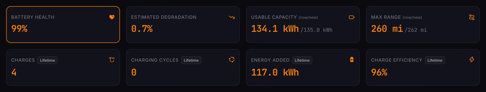
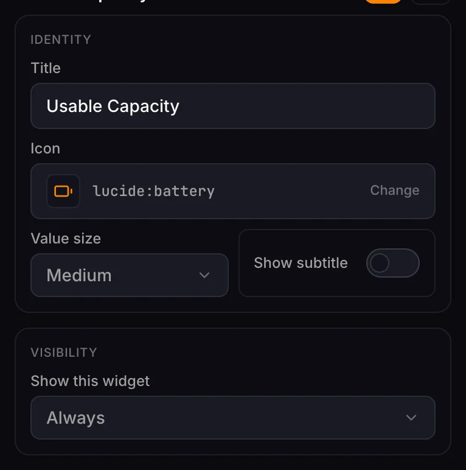
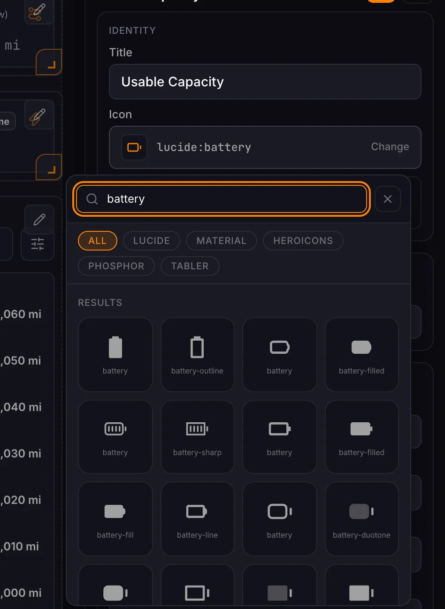
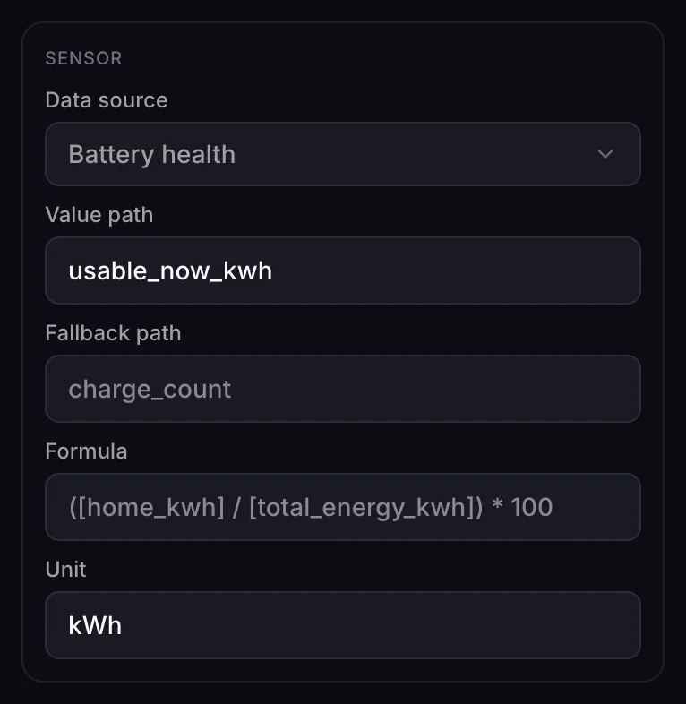
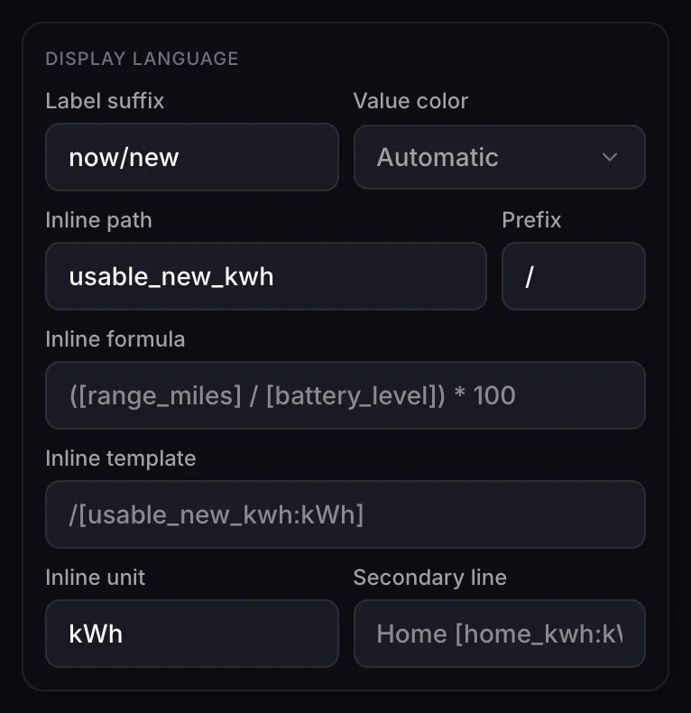
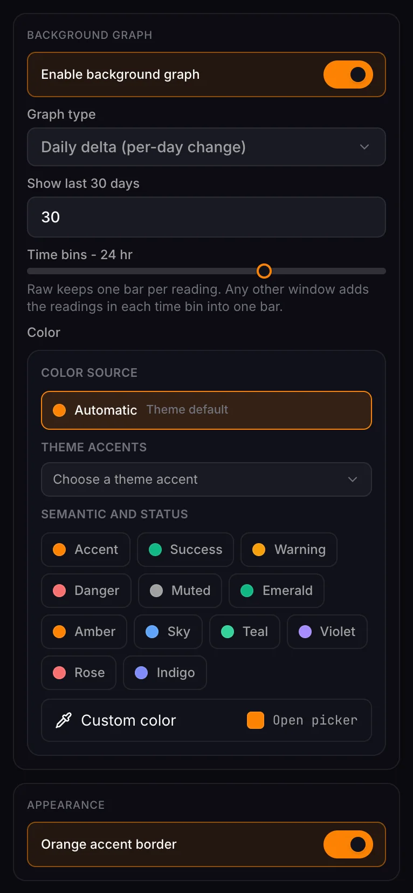

# Sensor chips

Sensor chips are the compact cards across the top of most dashboards, such as
**Total Miles**, **Usable Capacity**, and **Home Charging**. Each shows one
main value. It can also carry a smaller value beside it, a line of text
beneath it, and a small graph behind it. Every chip, built-in or new, is
built from the same settings, so anything a built-in chip does, you can do
too.



## Anatomy of a chip

Using **Usable Capacity** (top row, third from left) as the example:

- **Title** (`USABLE CAPACITY`) and an optional **label suffix** in smaller
  text (`now/new`).
- **Icon** in the top right corner.
- **Main value** (`134.1 kWh`), the number the chip is about.
- **Inline value** (`/135.0 kWh`), a smaller related value beside the main one.
- **Secondary line**, an optional line of text under the value, such as
  `Home 43.5 kWh / Away 73.5 kWh` on the Charging dashboard's Home Charging
  chip.
- **Background graph**, an optional line, area, or bar graph behind the value,
  such as the bars behind Total Miles on the Overview.
- **Badges.** **Lifetime** marks a chip that counts your whole history instead
  of the dashboard's selected dates. A **?** beside a title opens an
  explanation of how that value is calculated.

## Add or edit a chip

1. [Enter edit mode](./dashboard-editing.md#turn-on-edit-mode).
2. To add a chip, pick one under **Sensors** in the drawer's **Add widget**
   catalog. To change one, click its pencil.
3. Adjust the sections described below. The chip updates as you type.
4. Press **Save** in the drawer's top bar.

The built-in chips in the **Sensors** catalog come already set up. The fastest
way to build something new is often to add a built-in chip that is close to
what you want, then change it.

## Identity and visibility



- **Title** is the label across the top of the chip.
- **Icon**: press **Change** to search thousands of icons by name. Filter the
  results by icon set: Lucide, Material, Heroicons, Phosphor, or Tabler.
- **Value size** makes the main value **Small**, **Medium**, or **Large**.
- **Show subtitle** adds a line of your own text to the chip.
- **Show this widget**: **Always**, **Vehicle plugged in**, or **Vehicle
  unplugged**. See
  [Show a widget only when plugged in or unplugged](./dashboard-editing.md#show-a-widget-only-when-plugged-in-or-unplugged).



Icon search runs through your Riviamigo server, using the **Iconify**
connection in **Settings > External Connections**. With that connection off,
chips keep the icons they already have, but you can't search for new ones.

## Choose the value

The **Sensor** section decides which number the chip shows. Start with a
**Data source**:

| Data source | What it reads | How you pick the value |
| --- | --- | --- |
| **Metric catalog** | Trip, charging, and telemetry metrics for the dashboard's selected dates | Choose a **Metric** |
| **Battery health** | The battery health summary | A **value path** or a **formula** |
| **Charging summary** | Charging totals for the dashboard's selected dates | A **value path** or a **formula** |
| **Vehicle status** | The vehicle's latest live status | A **value path** or a **formula** |

### Metric catalog

Pick a **Metric**. Riviamigo calculates its value for the dashboard's selected
dates. For example, Total Miles is the distance driven in that range, and
Battery Level is the latest reading. The **Aggregation** choice (Latest, Sum,
Average, or Count) is saved with the chip but doesn't currently change the
value shown.

The metrics are Total Miles, Trip Miles, Total Trips, Energy Charged, Charging
Sessions, Total Cost, Avg Session Energy, Avg Efficiency, Avg Gross
Efficiency, Avg Outside (estimated), Avg Trip Duration, Battery Level,
Estimated Range, Odometer, Outside Temp, Speed, Power, and the pressure of
each tire.

### Battery health, Charging summary, and Vehicle status

These sources each provide a set of named fields. Point the chip at one of
them, or combine several with a formula.



- **Value path** is the field to show, such as `usable_now_kwh`.
- **Fallback path** is a second field, used when the first has no value.
- **Formula** calculates the value from several fields instead. When a formula
  is set, it is used in place of the value path. See [Formulas](#formulas).
- **Unit** formats the result. Use one of these units, and Riviamigo formats
  the value, converting it to the units in **Settings > Units** where they
  apply:

  | Unit | Formatted as |
  | --- | --- |
  | `mi` | Distance (miles or kilometers) |
  | `mph` | Speed |
  | `C` | Temperature (stored in Celsius; shown in your unit) |
  | `psi` | Pressure |
  | `kWh`, `kW` | Energy, power |
  | `Wh/mi` | Efficiency |
  | `USD` | Currency |
  | `min` | Duration |
  | `%` | Percentage |

  Any other unit, or none, shows the plain number.

The fields each source provides are listed in
[Field reference](#field-reference) at the end of this page.

## Formulas

A formula is plain arithmetic over fields. Wrap each field name in square
brackets:

```text
([home_kwh] / [total_energy_kwh]) * 100
```

- Use `+`, `-`, `*`, `/`, parentheses, and numbers.
- `[status.<field>]` reads the vehicle's live status from any chip, whatever
  its data source. For example, `[status.range_miles]` works in a Battery
  health chip.
- If a field has no value, or the formula divides by zero, the chip shows `-`
  instead of a wrong number.
- Formulas can only do arithmetic. They can't run code or reach anything
  outside Riviamigo.

## Wording, inline values, and the secondary line

The **Display Language** section adds the smaller pieces around the main value.



- **Label suffix** adds small text after the title, such as `now/new`.
- **Value color**: **Accent** uses the theme's accent color, **Default** uses
  the normal text color, and **Automatic**, offered for chips that belong to a
  data category such as charging or battery, uses that category's theme color.
- **Inline value** sits beside the main value. Fill in one of these. If you
  fill in more than one, the template wins, then the formula, then the path.
  - **Inline path**, **Prefix**, and **Inline unit**: one field with a prefix,
    for example `/` and `kWh` to show `/135.0 kWh`.
  - **Inline formula** (with **Prefix** and **Inline unit**): a calculated
    value.
  - **Inline template**: free text with fields in it. See
    [Templates](#templates).
- **Secondary line** is a template shown on its own line under the value.

### Templates

A template is text with fields dropped in. Write each field as
`[field:unit]`. The unit is optional and uses the same unit codes as above, or
`int` for a whole number:

| Template | Shows |
| --- | --- |
| `Home [home_kwh:kWh] / Away [away_kwh:kWh]` | `Home 43.5 kWh / Away 73.5 kWh` |
| `([charging_cycles:int] cycles)` | `(12 cycles)` |
| `/[usable_new_kwh:kWh]` | `/135.0 kWh` |

If any field in a template has no value, the whole template is left blank, so
a chip never shows half a sentence.

## Background graph



Turn on **Enable background graph** to draw the chip's metric behind its value,
over the dashboard's selected dates. Graphs are drawn for **Metric catalog**
chips. Chips that read Battery health, Charging summary, or Vehicle status
have no series to draw.

- **Graph type**:
  - **Line** and **Area** draw the readings as a line, or as a line with the
    area under it filled.
  - **Bar** draws one bar per reading or per time bin.
  - **Daily delta (per-day change)** draws one bar per day for how much the
    value changed that day. It suits running totals: on Total Miles, each bar
    is the miles driven that day. **Show last N days** sets how many days to
    draw, from 1 to 365.
- **Smoothing** (Line and Area): goes from **Off** (readings joined by
  straight lines) and **Curve** (a rounded line through the same readings)
  through time windows from 15 minutes to 7 days, which average the readings
  over that window. Smoothing only changes the drawing, never the value on the
  chip.
- **Time bins** (Bar and Daily delta): **Raw** keeps one bar per reading. Any
  other window adds the readings in each time bin into one bar.
- **Color**: **Automatic** follows the theme, or pick a theme accent, a status
  color, or any custom color.

## Appearance

**Orange accent border** outlines the chip in the accent color to make it
stand out, like Total Miles on the Overview.

## Recipes

### Share of charging done at home

On the Charging dashboard, add a chip and set:

- **Data source**: Charging summary
- **Formula**: `([home_kwh] / [total_energy_kwh]) * 100`
- **Unit**: `%`
- **Secondary line**: `Home [home_kwh:kWh] / Away [away_kwh:kWh]`

### Average tire pressure

- **Data source**: Vehicle status
- **Formula**: `([tire_fl_psi] + [tire_fr_psi] + [tire_rl_psi] + [tire_rr_psi]) / 4`
- **Unit**: `psi`
- **Inline template**: `low [tire_min_psi:psi]`

### Range per percent of charge

- **Data source**: Vehicle status
- **Formula**: `[range_miles] / [battery_level]`
- **Unit**: `mi`
- **Label suffix**: `per 1%`

### Odometer with miles driven each day

- **Data source**: Metric catalog
- **Metric**: Odometer
- **Background graph**: Daily delta, last 30 days

The chip shows the odometer reading, and each bar behind it is one day's
driving.

## Field reference

These are the fields you can use in value paths, formulas, and templates.

**Battery health**

| Field | Meaning |
| --- | --- |
| `usable_now_kwh` | Usable battery capacity now |
| `usable_new_kwh` | Usable capacity when new |
| `battery_health_pct` | Battery health, percent |
| `estimated_degradation_pct` | Estimated degradation, percent |
| `charge_count` | Number of charges |
| `charging_cycles` | Full-equivalent charging cycles |
| `total_energy_added_kwh` | Energy added by charging |
| `total_energy_used_kwh` | Energy used |
| `charging_efficiency_pct` | Charging efficiency, percent |

**Charging summary** (for the dashboard's selected dates)

| Field | Meaning |
| --- | --- |
| `total_energy_kwh` | Energy charged |
| `total_cost_usd` | Charging cost |
| `session_count` | Charging sessions |
| `home_kwh`, `away_kwh`, `unknown_location_kwh` | Energy by location |
| `away_kwh_including_unknown` | Away energy plus energy at unknown locations |
| `ac_kwh`, `dc_kwh` | Energy by AC and DC charging |
| `charging_cycles` | Charging cycles |
| `charging_efficiency_pct` | Charging efficiency, percent |
| `max_charge_limit_pct` | Highest charge limit used |
| `max_charge_rate_kw` | Fastest charge rate |
| `free_session_count` | Sessions that cost nothing |
| `known_cost_session_count`, `unknown_cost_session_count` | Sessions with and without a known cost |
| `rivian_paid_total_usd` | Amount billed by the Rivian network |

**Vehicle status** (the latest live reading)

| Field | Meaning |
| --- | --- |
| `battery_level` | State of charge, percent |
| `range_miles` | Estimated range, miles |
| `battery_limit` | Charge limit, percent |
| `battery_capacity_kwh` | Battery capacity |
| `time_to_end_of_charge_min` | Minutes until charging finishes |
| `speed_mph` | Speed |
| `odometer_miles` | Odometer |
| `altitude_m` | Altitude, meters |
| `cabin_temp_c`, `driver_temp_c`, `outside_temp_c` | Temperatures, Celsius |
| `tire_fl_psi`, `tire_fr_psi`, `tire_rl_psi`, `tire_rr_psi` | Tire pressures |
| `tire_min_psi` | Lowest tire pressure |

For how the underlying data is collected and stored, see the
[Metrics reference](../metrics-reference.md) and
[Dashboard data map](../dashboard-data-map.md).
