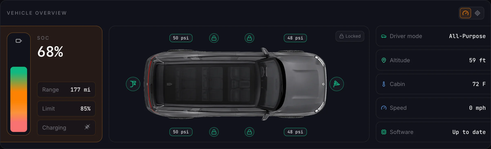
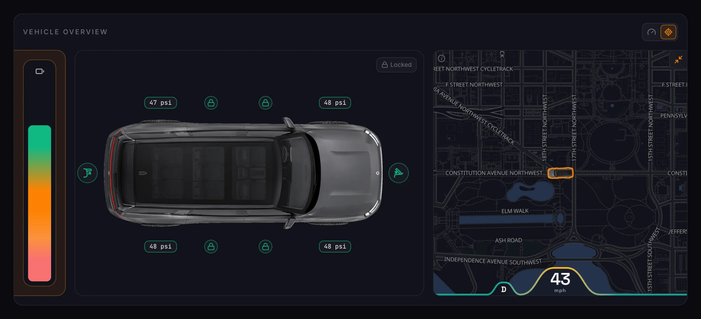
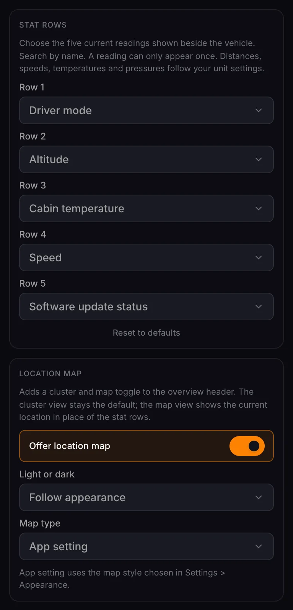
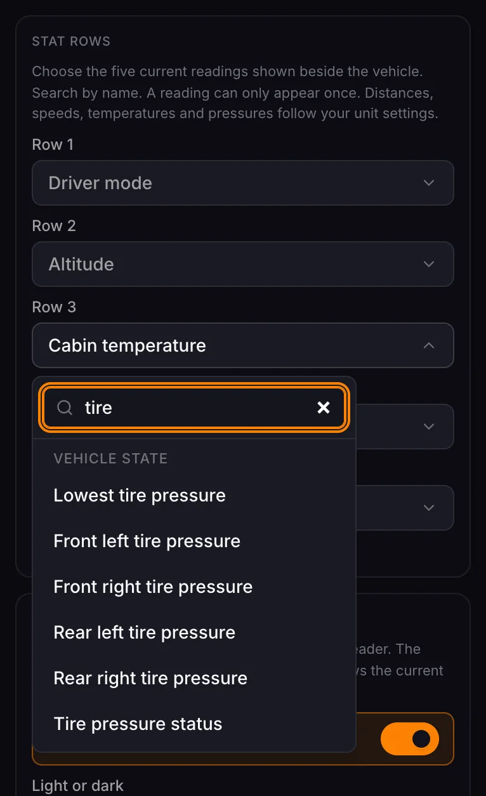

# Vehicle Overview

The Vehicle Overview is the large panel at the top of the Overview dashboard.
It shows the vehicle's current state at a glance and can switch to a map of
where the vehicle is. It is a normal dashboard widget, so you can also add it
to any other dashboard from the editor's **Add widget** catalog.

## Cluster view

The cluster view has three areas, left to right:

- **Battery.** A charge bar and the state of charge, with the estimated range,
  the charge limit, and whether the vehicle is charging. While it charges, the
  time to full appears here too.
- **Vehicle.** An overhead image of your vehicle with a pressure reading at
  each tire, outlined in green, amber, or red by tire health. Lock icons sit on
  each door, the frunk, and the rear gate, plus the side bins on an R1T. The
  padlock in the corner shows whether the vehicle is locked: green and closed
  when every lock is locked, open when any is not. Hover over it, or tap it on
  a phone, to see each lock by name. With Rivian's own vehicle artwork, open
  doors are drawn open on the image.
- **Stat rows.** Five current readings, such as driver mode, altitude, cabin
  temperature, speed, and software update status. You choose which five; see
  [Choose the stat rows](#choose-the-stat-rows).

The panel picks its layout from its own width. Narrower placements tighten the
spacing, and on a phone the three areas stack.

## Map view

The two buttons in the panel's top right switch between the **cluster** view
(the gauge) and the **current location** map (the crosshair). The map takes
the place of the stat rows. The battery and the vehicle image stay.

- **The marker** is a small overhead image of your vehicle, outlined in the
  accent color and turned the way its nose points. Rivian reports the direction
  of travel, so after you back into a space Riviamigo turns that reading around
  to show the way the vehicle actually faces.
- **The wave** along the bottom of the map shows the gear and speed while the
  vehicle is moving, or **Parked**. Parked on a charger, a bolt beside
  **Parked** shows the charging state: grey over **Plugged in** while no power
  is flowing, lit over **Charging** while it is.
- **Expand** (the arrows in the map's corner) gives the map more room. The
  battery shrinks to its charge bar and the map takes the space. On a phone it
  makes the map taller instead. Press it again to go back.

Your choice of cluster or map, and whether the map is expanded, are saved to
your account. The Overview opens the way you left it, on any device.

### Navigation

While the vehicle is navigating to a destination, the map also shows where it
is going:

- **The route** the vehicle planned is drawn ahead of it, with the part
  already driven dimmed.
- **The destination** is marked with a gold Rivian mark and its name. A
  charging stop the vehicle added along the way is marked with a bolt, and any
  other stop with a pin.
- **The wave** gains the arrival time, with the time left beneath it. In the
  narrow three-column layout the arrival time takes the gear's place.
- **Whole route** (the route button beside Expand) zooms out to show what is
  left of the trip: the vehicle, the remaining stops, and the destination.
  Press it again to go back to following the vehicle. The button is only there
  while the vehicle is navigating, and each new trip starts out following the
  vehicle.

The route appears when the vehicle reports one and disappears when navigation
ends. It comes from the vehicle's own navigation, so it needs
[extended vehicle telemetry](./extended-vehicle-telemetry.md), and nothing is
shown for a drive without a destination. The route, stops, and arrival time
are shown live only and are never stored; see [Privacy](../privacy.md).

The map needs a reported location. Until the vehicle has reported one, the
map says **No location reported yet**. The street map behind the marker comes
from the **Map basemap** connection in **Settings > External Connections**.
With that connection off, the vehicle is still placed, on a plain background.
See [External connections](./external-connections.md).

## Customize the Vehicle Overview

[Enter edit mode](./dashboard-editing.md#turn-on-edit-mode) and click the
Vehicle Overview's pencil. Besides the title and visibility, it has two
sections of its own.

### Choose the stat rows

**Stat rows** has one picker per row. Each picker is searchable: type part of a
name, such as "tire", to filter the list.

The readings come in three groups:

- **Vehicle state**: live readings such as driver mode, speed, altitude,
  cabin, outside and driver-zone temperatures, odometer, power, heading, each
  tire's pressure, the lowest tire, charge limit, charger state, and time to
  full.
- **Vehicle systems**: status readings such as the 12V battery, the
  high-voltage battery's thermal state, current and available software, the
  charge port, seat and steering wheel heating, defrost, Pet Mode, Gear Guard,
  the tonneau, the alarm, and brake and washer fluid.
- **Battery health**: battery health, estimated degradation, usable capacity,
  maximum range, charges, charging cycles, energy added, and charge
  efficiency.

A reading can appear in only one row, so readings already in use are left out
of the other pickers. Distances, speeds, temperatures, and pressures follow
your unit settings. **Reset to defaults** goes back to driver mode, altitude,
cabin temperature, speed, and software update status.

### Location map

- **Offer location map** shows or hides the cluster and map buttons. Turn it
  off to keep this panel on the cluster view.
- **Light or dark** follows the app's appearance by default, or always uses a
  light or a dark map.
- **Map type** uses the map style from **Settings > Appearance** by default
  (**App setting**). You can pick a specific style for this panel instead:
  Positron, Bright, Liberty, Dark, Fiord, or 3D (Liberty).

Press **Save** in the drawer's top bar to keep your changes. See
[Save or discard](./dashboard-editing.md#save-or-discard).
